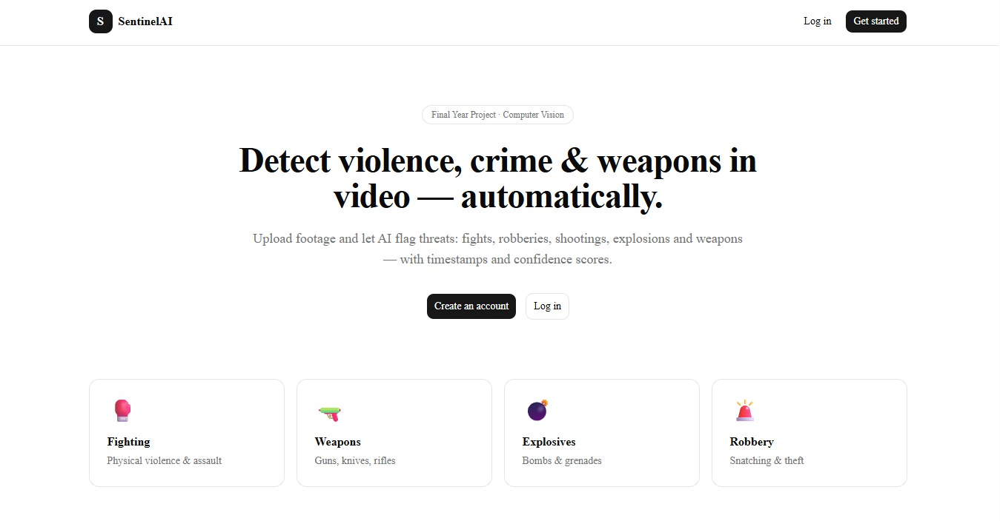
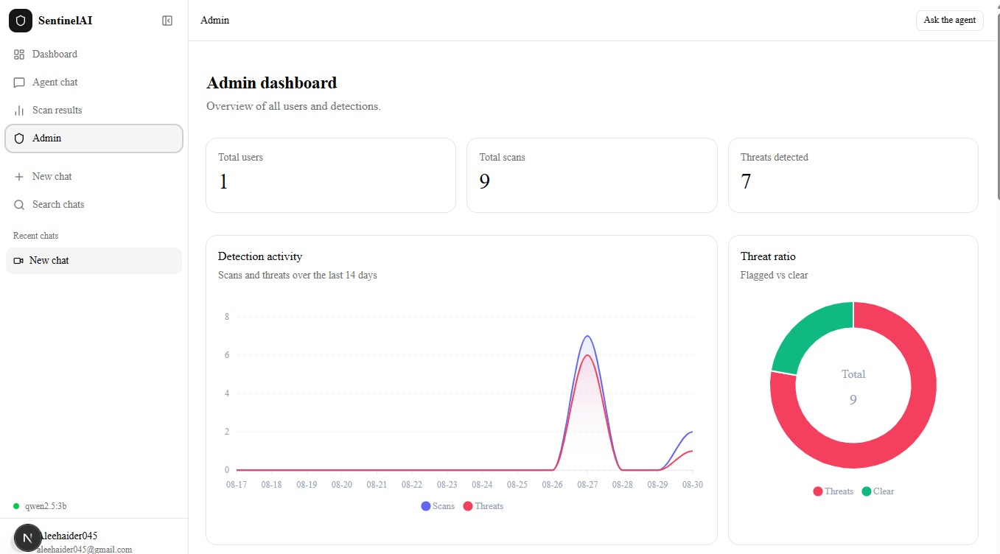

# Six AI Models Watched the Same CCTV Clip. Adding More Made It Worse.

### Building SentinelAI — a video threat detection platform — and the ensembling mistake that nearly sank it

*by [@metosys](https://medium.com/@metosys)*

---

A CCTV operator watches 30 cameras at once. Attention collapses after about 20 minutes — this is well documented, and it is the entire reason the surveillance industry exists in the shape it does. Cameras are cheap. Watching them is not.

So for my final year project I built **SentinelAI**: upload a video, get back timestamped incidents — weapons, fighting, robbery, harassment — with the clip cut, the frames boxed, and a chat agent you can ask about it afterwards.



The part worth writing about is not the models. It is the mistake I made with them, because it was the kind of mistake that looks like good engineering right up until you check the output.

---

## The setup

The stack, briefly, so the rest makes sense:

- **FastAPI** for the API, **ARQ** for the worker queue
- **PostgreSQL 14** via Prisma, **Redis** for queue + cache + pub/sub, **MinIO** for video, frames and clips
- **Next.js 15** front end
- **Seven models**: a YOLOv8n weapon detector, OWLv2 for zero-shot objects, two VideoMAE classifiers (violence, and UCF-Crime actions), Qwen2.5-VL 7B for local vision-language analysis, Qwen2.5 3B for chat, and Google Gemini as a hosted VLM

Everything ships in one 5.4 GB Docker image with all weights baked in. I verified it downloads nothing at runtime by loading every model in a container started with `--network none`.

---

## The mistake: "first positive wins"

I had six detection backends. The obvious move — the one that feels like it should work — is to run them in sequence and take the first one that finds something. More models, more coverage, right?

That is exactly what I built. It was the `auto` mode: run Gemini, then the violence classifier, then the action model, and return the first positive result.

It performed terribly. Not "slightly noisy" — **a clean video was almost impossible to report as clean.**

Here is the failure, concretely. I fed it a clip of people playing with a ball. Gemini watched the whole video and correctly reported nothing. That verdict was thrown away the moment the next model in the chain — a binary violence classifier with no ability to abstain and no idea what it is actually looking at — saw fast human motion and guessed "violence."


The bug is structural, and once you see it you cannot unsee it:

> **A chain of models that takes the first positive only ever adds ways to say yes. It never adds a way to say no.**

Every stage you add can only increase the false positive rate. Six models chained this way don't vote — they take turns until one of them makes a mistake. With independent false positive rates of even 10% each, three stages gets you to roughly a 27% chance of inventing a crime in a clip of a children's birthday party.

For a security product that is worse than useless. An operator who gets a false alarm on the third clip stops trusting the fourth.

---

## The fix: decide which model is allowed to say no

The rewrite was smaller than the diagnosis. Gemini is the only backend in the system that actually *reads a scene* rather than pattern-matching pixels. So its answer is final — **in both directions**.

```python
async def _run_auto(video_path: Path, progress: ProgressFn) -> dict:
    """Cascade: Gemini, then violence classifier -> action model as a fallback.

    **Gemini decides when it runs.** The stages below it are a fallback for a
    Gemini that could not answer, not a second opinion on one that did.
    """
    # 1) Gemini — it is the only one that understands the scene, so its
    #    "nothing here" is worth as much as its "here it is": both final.
    try:
        result = await asyncio.to_thread(
            detect_violence_llm, video_bytes=video_bytes, mime_type=mime
        )
        return result          # <- returns even when it found nothing
    except LlmDetectionError as exc:
        logger.info("auto: Gemini skipped (%s)", str(exc)[:120])

    # 2) and 3) only run when Gemini could not answer at all.
```

The local classifiers now only run when Gemini genuinely could not answer — no API key, exhausted quota, a network failure. They are a **fallback for silence**, not a second opinion on a verdict.

The distinction sounds pedantic. It is the whole ballgame.


That dashboard shows both halves of the argument at once.

The row marked **Clear** is an animated promotional graphic — text on a moving background. Under the old cascade this was exactly the kind of clip that got flagged, because *something* was moving. Now Gemini's "contains no safety incidents" is the answer, and it survives to the report.

The three rows analysing the same phone-snatching compilation show why. Run through the `violence` classifier, the summary reads **"Detected violence across 2 segment(s)."** Run through Gemini, it reads **"Compilation showing multiple incidents of phone and bag snatching by individuals on bicycles, e-bikes, and scooters."**

Both flagged it. Only one of them knows what happened. That asymmetry is the justification for letting one model overrule five.

### The retry logic that turned out to be a correctness fix

This reframing had a consequence I did not anticipate. Gemini's free tier returns `503 high demand` fairly often, and it clears in seconds. I had originally treated retrying it as a robustness nicety.

Once the cascade meant "Gemini failing hands the verdict to the least reliable model in the system," retrying became a **correctness** issue:

```python
# Retrying matters more here than the usual robustness argument. The cascade
# treats "Gemini could not answer" as permission to fall through to the local
# classifiers, and those are the ones that call a clip of a ball a fight. So a
# blip that lasts two seconds did not degrade the answer, it changed who gave
# it — silently, and to the least reliable model in the system.
_RETRY_STATUSES = frozenset({429, 500, 502, 503, 504})
```

There was a second trap underneath it. I wrote the usual exponential backoff — 2s, 4s, 8s — and it failed every time under rate limiting. Google's 429 response carries a `RetryInfo` field telling you how long to actually wait, and for a rate-limited call it routinely asks for ~32 seconds. Doubling from two seconds never reaches that; it just fails four times in fifteen seconds and reports defeat.

So: honour the number the server gives you, and cap it at 45s — past that, the local model answering now beats Gemini answering in two minutes.

---

## One event is one incident

The second thing that made the output unusable had nothing to do with accuracy. The models were right and the report was still wrong.

Ask Gemini to watch a 20-second fight and it returns:

```
"pushing"   3.0 – 7.0
"punching"  5.0 – 9.0
"assault"   4.0 – 11.0
```

Three rows. All three correct. The UI rendered three incident cards and three overlapping bands on the timeline — and an operator reads that as **three separate fights**.

So there is a consolidation pass. Rows that overlap, or sit within a gap threshold of each other, are merged into the single event they describe, and the most confident row wins the story:

> *The merged incident keeps that row's label, category and description; the span is the union, and the peak is where the winning row sat. Averaging descriptions would invent a sentence no model wrote.*

That last line is a rule I would defend anywhere near an LLM pipeline. It is tempting to blend outputs into one smooth summary. Don't — you produce text that no model actually asserted, and you can no longer trace any claim back to its source.

The peak second matters beyond the prose, too. It is where the cover frame gets captured. A merged 3.0–11.0 span has a midpoint of 7.0, which may well be the lull *between* two blows. The winning row's own centre is the moment a model was actually looking at.


This is what consolidation buys you, and the line under the player is the whole product in one number: **36 seconds flagged out of 7 minutes 41**.

Eight distinct collisions, each narrowed to a band you can click. An operator scrubs 8% of the footage instead of watching all of it. Without the merge pass those eight events were closer to thirty bands, and "thirty things happened in this video" is not a finding — it is a second video to review.

### Flagging everything is flagging nothing

The related failure: a model that marks the entire clip as an incident. Technically a positive; practically it tells the operator to watch all of it, which is the same as telling them nothing.

Anything exceeding a coverage ceiling gets pulled back to the moment of peak confidence — and the report says so in plain language rather than quietly narrowing the span behind the user's back:

```python
note = (" The model flagged the entire clip, so the marked section is"
        " where it was most certain.")
```

Honest hedging beats a confident-looking span you silently rewrote.

---

## Making a slow pipeline feel fast

A vision model takes anywhere from five seconds to several minutes. A browser cannot sit on that request, and a spinner for two minutes reads as a crash.

Upload returns `202 Accepted` with a job ID in about a second, before any model has run. The worker then streams progress over Server-Sent Events.

![Pipeline diagram. The browser POSTs to FastAPI, which writes the video to MinIO, a job row to Postgres and an ARQ job to Redis, then returns 202 with a job id in about a second before any model has run. The ARQ worker dequeues and runs four stages: sample frames at 5 to 30 percent before any model loads, run the detection backend at 30 to 70, cut clips and draw boxes at 70 to 90, caption and complete at 90 to 100. Events go to Postgres and fan out over Redis pub/sub to the browser as SSE and to customer servers as HMAC-signed webhooks](diagrams/pipeline.png)

The trick that mattered most was **ordering the work by when the user can see it**. Decoding a dozen preview frames takes under a second. So the worker samples, uploads and announces frames *before* it loads any model:

```
 0.0s  job.queued
 0.0s  job.started
 1.0s  frame.ready    7%   <- first image on screen
 2.1s  frame.ready   30%   <- all 12 frames on screen
 2.2s  job.progress  40%   YOLO starts
 7.6s  job.completed 100%
```

Real content at 1.0s instead of a spinner until 7.6s. The total time is identical. The experience is not.

### One event log, two transports

Every event is appended to a `job_events` table, and that table is the single source of truth. Redis pub/sub fans it out to browsers over SSE; the same rows go to registered webhook endpoints as HMAC-signed POSTs.

A browser and a webhook consumer receive **byte-identical payloads** — only the transport differs, because a browser cannot receive an inbound HTTP callback.

Each event carries a per-job `sequence`, sent as the SSE `id:`. When a connection drops, the browser resends it as `Last-Event-ID` and the server replays only what came after. One detail worth stealing: the subscription is opened *before* history is replayed, which closes the window where an event published between the two steps would be lost forever.

---

## What a classifier structurally cannot do

One detection category forced an architectural decision: **harassment**.

I could not make it work with classifiers, and eventually understood why. Harassment is about intent, consent and persistence. None of those is an object, and none is a pose. The UCF-Crime dataset the action model is fine-tuned on does not even have a `harassment` label — there is no output neuron to light up.

| Capability | Models that can do it |
|---|---|
| Weapons as objects | YOLOv8n, OWLv2 |
| Arbitrary objects | OWLv2 |
| Actions over time (fighting, robbery) | VideoMAE action, VideoMAE violence |
| **Harassment** (needs intent) | **Gemini, Qwen2.5-VL only** |

This is the real argument for putting a vision-*language* model in a CCTV pipeline. Not that it is better at spotting a knife — YOLO is faster and 2,500× smaller at that. It is that an entire class of incidents is only expressible in language.

### The cost of keeping it local

I wanted a keyless fallback, so Qwen2.5-VL 7B runs in-image as a last resort. Measured honestly:

- **16.6 GB** on disk, **~17 GB** RAM when loaded, pushing peak requirements to 32 GB
- Minutes per clip on CPU, versus seconds for Gemini
- It sees **8 frames at 512×384** — not the video

That frame budget is the real gap. An incident that happens between two sampled frames is simply invisible to it. You can raise the count for better recall at a roughly linear cost in inference time, which on CPU gets expensive fast.

Writing those numbers down changed the design: the local VLM became an opt-in build flag rather than a default. Setting `INCLUDE_QWEN_VL=false` drops 16.6 GB from the image.

---

## The agents, and the one that writes SQL

Three LLM agents sit on top of the pipeline: an orchestrator you chat with, a per-scan Q&A agent grounded in one video's incidents and frames, and a database analyst that turns plain English into SQL over your past scans.

That last one is the one people get nervous about, correctly. The safety model is not "ask the model nicely not to write a DELETE."

The generated statement runs on top of a fixed CTE prelude that is itself scoped to the caller — `$1` is always the user id, injected by the server, never by the model. The model writes a `SELECT` against a small curated view and nothing else. Then it is validated before it runs:

```python
if not sql.lower().startswith("select"):
    raise DbAgentError("Only SELECT statements are allowed.")
...
if not _LIMIT.search(sql):
    sql = f"{sql} LIMIT {MAX_ROWS}"
```

Single statement, read-only, row-capped, and the data it can even reach is pre-filtered to one user. The model's output is treated as untrusted input, because that is exactly what it is.

The orchestrator also gets presentation tools, which turned out to matter more than I expected. `control_video_playback` drives the browser's player and `show_frame_at` captures a still at one timestamp — so when you ask "what happened at 3:20?" the agent can *show you the frame* rather than describing it back in prose. An answer you can see beats an answer you have to trust.

One more recommendation for anyone shipping agents: **every system prompt lives in a `.md` file**, not a string constant.

```
agentic/prompts/
├── orchestrator/system.md
├── db_agent/{schema,sql_system,insight_system}.md
└── scan_chat/{system,segment}.md
```

Prompt wording is the single biggest lever on answer quality, and it is the thing you iterate on most. Keeping it as text means reword a rule, restart the API, done — no code change, and a readable git diff of exactly how the agent's instructions evolved.

---

## Shipping it: one image, five processes

An FYP that only runs on the machine it was built on is a demo, not a project. The deployment target was "one command on a fresh box."

The backend image bundles PostgreSQL, Redis, MinIO, the API and the ARQ worker, supervised by `supervisor`, with every model weight baked into its own build stage:

```powershell
docker compose up -d --build
```

Two containers, and `docker compose logs -f backend` gives you all five processes in one interleaved stream. The first build takes 30–50 minutes — torch, transformers and ~2.1 GB of weights — but the weights live in a separate stage, so changing code or even `requirements.txt` never re-downloads them.

Two decisions I would repeat:

**Pin the database major version to match the data directory.** The image ships PostgreSQL 14 specifically because Debian 13 would give 17, which cannot read a 14 data directory in place. That is a silent, unrecoverable-looking failure the first time you meet it.

**Make the cache TTL shorter than the credential it carries.** Cached report payloads embed presigned MinIO URLs. The cache TTL is 120s; the signature lifetime is 3600s. Deliberately far apart, so a cache hit can never hand the browser a dead link. Invalidation bumps a per-user generation counter with a single `INCR`, which logically expires every key for that user without scanning the keyspace.

Redis is optional everywhere else: if it is down, cached loaders run directly, SSE falls back to polling `job_events`, and only the queue genuinely stops working.



---

## What I would tell myself at the start

**More models is not more accuracy.** It is more surface area for error, unless you have decided explicitly what each one is allowed to overrule. Ensembling requires a combination rule. "First hit wins" is not a combination rule; it is a maximum-noise function.

**Decide which model can say no.** Most classifiers cannot abstain. A model that can only vote yes should never get the last word.

**Correct output is not usable output.** Three accurate rows describing one fight is a wrong report. Most of my work after the models started functioning was turning true statements into something a human could act on.

**Latency is about ordering, not speed.** I never made the models faster. I moved the cheap visible work to the front, and the system felt transformed.

**Measure resource costs before you design around a model.** "Local 7B VLM as a fallback" sounded free. It was 16.6 GB and a jump from 8 GB of RAM to 32 GB.

**Treat your own model's output as untrusted input.** Especially when it writes SQL.

---

*SentinelAI was built as a final year project: FastAPI, Prisma, PostgreSQL, Redis, MinIO, ARQ and Next.js, with YOLOv8n, OWLv2, VideoMAE, Qwen2.5-VL and Gemini.*

*Written by **[@metosys](https://medium.com/@metosys)**. If you are building something similar and want detail on any part of the pipeline — the cascade, the SSE resume logic, or the SQL agent's sandbox — leave a comment and I will go deeper in a follow-up.*
